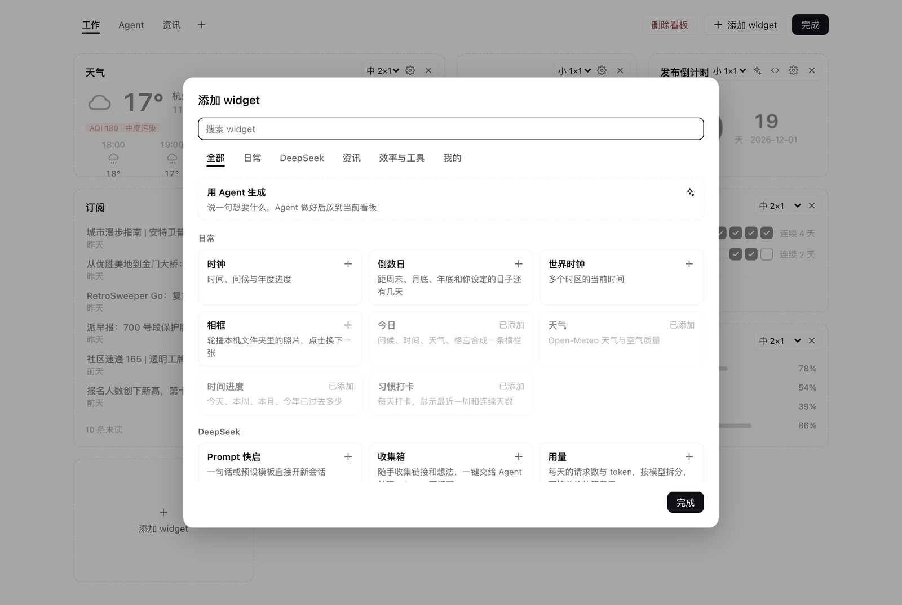
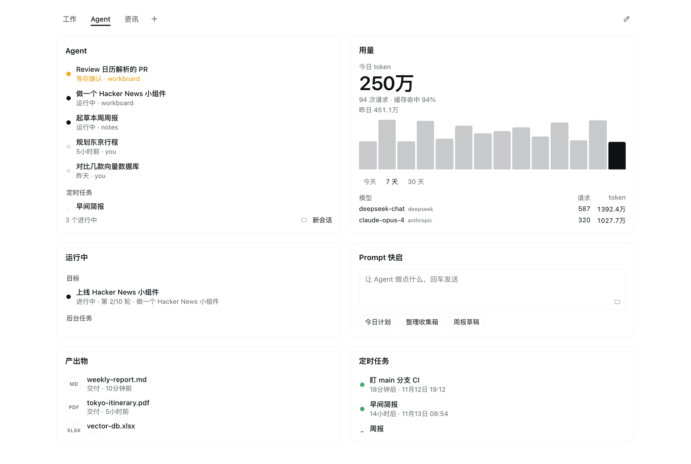
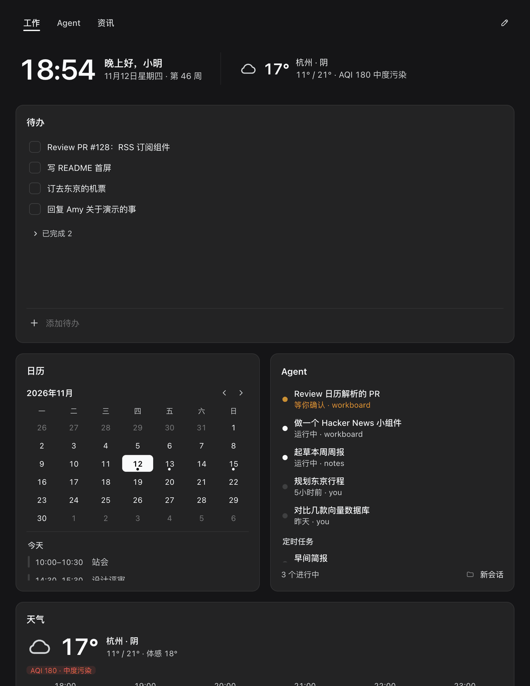

# 工作台 Workboard

**[DeepSeek Harness](https://github.com/deepseek-ai/deepseek-harness) 的模块化工作台插件。内置 52 个 widget，开箱即用；不够用的，让 Agent 现做。**

[English](README.en.md) · [](https://www.npmjs.com/package/dsh-workboard) [](LICENSE)


## 亮点

### 内置 52 个 widget，开箱即用

覆盖四大场景，打开组件库即可搜索、预览并连续添加到看板：

- **Agent 协作**：待确认与运行中会话、长程目标与后台作业、每日简报、Prompt 快启、Token 用量与费用估算、活跃热力图、服务状态、热门 MCP、产出物、定时任务、收藏会话
- **效率与开发**：待办、速记、ICS 日历、专注番茄钟、白噪音、快捷链接、快捷应用、Git 工作区、GitHub（PR / Issue）、发版追踪、包下载量、系统状态、最近文件、剪贴板、网络测速、本机端口
- **日常桌面**：今日横栏、时钟、世界时钟、天气、日出日落与月相、倒数日、节假日、历史上的今天、每日一词、时间进度、习惯打卡、本机相框、每日壁纸、正在播放
- **资讯与行情**：多源热榜、RSS / Atom 订阅、AI 论文、模型行情、大模型竞技场、视频订阅、A 股 / 港股 / 美股 / 汇率 / 加密货币行情、每日格言

绝大多数零配置即用；少数仅需填入城市、日历订阅链接或股票代码等个人信息。



### 不够用的，让 Agent 现做

用一句话描述想要的卡片，点击 **交给 Agent**，写好后自动放上当前看板。后续点卡片上的星光按钮即可让 Agent 微调；若运行报错，点 **让 Agent 修复** 即可把错误交回给它处理。

自定义 widget 运行在独立沙箱内，无法访问宿主页面、Cookie 或未授权网络，只能通过 Host 请求该卡片显式声明的接口地址。


### 专为 Agent 工作流打造

一块看板集中呈现需要你确认的会话、进行中的长程目标与后台作业、Token 用量、交付产出物和定时任务。反过来，Agent 也能在任意对话中通过内置工具直接读写你的待办、速记与自定义卡片。



### 模块化、自适应、克制

卡片吸附在四列网格上，提供六种尺寸档位，支持拖拽排布、自由缩放，并可按主题拆分到多个标签页看板。布局随窗口宽度自动重排，明暗主题跟随 Harness 切换。每张卡片只聚焦一件事，不设多余装饰。



### 数据留在本机，隐私可控

所有看板与个人数据均保存在本机 Harness profile 中。外部网络请求统一由 Host 端发出并缓存，前端页面不直连任何第三方服务。

## 快速开始

在 Harness 打开 **插件** → **添加插件**，输入包名并安装：

```
dsh-workboard
```

也可以直接对 Agent 说「安装插件 dsh-workboard」。命令行用户：`dsh plugin --profile web add dsh-workboard`。

安装后在左侧边栏打开 **工作台**。初始看板预置了今日、待办、热榜、产出物、剪贴板、日历、系统状态等常用组件；点击右上角 **编辑** → **添加 widget** 即可添加更多组件，或让 Agent 生成新卡片。

## 写给 AI Agent

如果你是在操作工作台的 Agent：

- **安装**：调用 `plugin_manager install_bundle`，`target` 填 `dsh-workboard`；从源码安装时填本仓库绝对路径（以软链接挂载，不复制文件）。
- **内置工具**：
  - `workboard_todos`：`list` · `add` · `complete` · `reopen` · `remove`
  - `workboard_note`：`read` · `append` · `replace`
  - `workboard_widget`：`list` · `get` · `create` · `update` · `set_data` · `remove`
  - `workboard_context`：只读，一次读取待处理、日程、天气、待办、习惯、速记、会话、运行中、定时任务、产出物、用量、Git 与 GitHub，可用 `sections` 只取部分
  - `workboard_brief`：`read` · `write`（每日简报，Markdown）
- **构建自定义 widget**：调用 `workboard_widget` 前先加载 `workboard-widget` skill（[`skills/workboard-widget.md`](skills/workboard-widget.md)），内含尺寸规范、`window.workboard` API、沙箱约束与主题变量。
- **配额与同步**：最多 50 个自定义 widget，单个 widget 的 HTML 与数据各不超过 200 KB。前端每 5 秒轮询一次，修改无需刷新页面即可生效。
- **存储路径**：`~/.dsh/storages/dsh_workboard.json`。

## 参考

<details>
<summary><b>全部 52 个内置 widget</b></summary>

| Widget | 档位 | 说明 |
|---|---|---|
| **DeepSeek（Agent 协作）** | | |
| 待处理 | `l` `t` `m` `w` | 等你确认的会话、卡住的目标、失败的后台作业、待 Review 的 PR 与结转待办按紧急程度排成一列，可直接跳转会话或完成待办 |
| Agent | `t` `l` `m` `w` | 等你确认的会话置顶，其次为运行中和最近会话；展示即将触发的定时任务，支持一键新开会话 |
| 运行中 | `t` `l` `m` `w` | 汇总各会话的长程目标（Goals）与后台作业（Jobs），可直接跳转会话或停止作业 |
| 每日简报 | `l` `t` `w` `m` | Agent 汇总工作台数据写成的今日简报；可随时生成，也可开启每天定时生成 |
| Prompt 快启 | `m` `w` `l` `t` `s` | 输入提示词或点击预设，直接在指定工作区新开会话并发送 |
| 用量 | `l` `t` `m` `w` `s` | 从本机会话日志统计 Token、请求数、缓存命中率及各模型占比；填入单价或开启 OpenRouter 公开价后可估算花费 |
| 活跃热力图 | `w` `l` `m` | 过去一年每天的 Agent 用量热力图，按 token 或请求数着色，附活跃天数与连续天数 |
| 服务状态 | `t` `l` `m` `s` `w` | DeepSeek、Claude、OpenAI、GitHub、npm 及任意 Statuspage 状态页，有故障的服务置顶 |
| 热门 MCP | `l` `t` `m` `w` | npm 周下载热门、GitHub 高星与官方 MCP Registry 最新上架的 MCP Server，支持按关键词过滤 |
| 产出物 | `t` `l` `m` `w` | 按时间倒序展示 Agent 交付的文件；支持直接打开、在 Finder 中定位或跳回原会话 |
| 定时任务 | `t` `l` `m` `w` | 查看所有定时任务的执行周期与下次触发时间；支持立即运行、暂停、恢复与删除 |
| 收藏会话 | `t` `l` `m` `w` | 固定常用会话并展示最新一条消息预览 |
| **效率与工具** | | |
| 待办 | `l` `m` `t` | 未完成项置顶、已完成项折叠；跨天未完成项自动标记「结转」 |
| 速记 | `l` `t` `m` `s` | 自动保存的随手记，光标所在行可一键转为待办 |
| 日历 | `t` `l` `s` `m` | 月视图与当日日程列表，支持订阅多个 ICS 地址并展开重复规则 |
| 专注 | `m` `s` | 番茄钟，切换看板或离开面板不中断，到点发送系统通知并统计今日专注次数 |
| 白噪音 | `m` `s` `w` `t` | 在页面内合成雨声、海浪、风声、篝火与粉噪 / 棕噪，可叠加；切换看板或离开面板不中断，可在专注时自动播放 |
| 快捷链接 | `m` `s` `w` `t` `l` | 每行一条「名称 网址」，仅允许 `http`、`https` 与 `mailto` |
| 快捷应用 | `m` `s` `w` `t` `l` | 从可搜索的本机应用列表中挑选常用 App，一键打开；正在运行的带圆点（支持 macOS 与 Windows） |
| Git 工作区 | `t` `l` `m` `w` | 展示各仓库当前分支、未提交改动、领先 / 落后提交数及上游已删除分支；默认读取 Harness 工作区 |
| GitHub | `t` `l` `m` `w` | 复用本机已登录的 `gh` CLI，展示待你 Review 的 PR、你发起的 PR 以及指派给你的 Issue |
| 发版追踪 | `t` `l` `m` `w` | 聚合多个 GitHub 仓库的最新 Release 与变更摘要，可过滤预发布版本 |
| 包下载量 | `t` `m` `l` `s` `w` | 追踪 npm、PyPI（`pypi:包名`）与 Crates.io（`crate:包名`）包的周下载量、月下载量与最新版本 |
| 系统状态 | `m` `s` `t` `l` `w` | 实时查看 CPU、内存、磁盘、电池状态及最近 5 分钟 CPU 负载曲线 |
| 最近文件 | `t` `l` `m` `w` | 列出 `~/Downloads`、`~/Desktop` 或指定文件夹的最新文件；支持打开、定位或直接发给 Agent |
| 剪贴板 | `t` `l` `m` `w` | 记录面板打开期间复制过的文本；支持一键重复制，或套用「翻译」等预设发给 Agent |
| 网络 | `m` `s` `t` `l` `w` | 实时上下行速率、本机与公网 IP、系统代理状态，以及到指定站点的连接延迟 |
| 端口 | `t` `l` `m` `w` | 本机正在监听的 TCP 端口与对应的开发服务、项目目录；可在浏览器打开、定位目录或停止进程（默认隐藏 App 与系统进程） |
| **日常** | | |
| 今日 | 横栏 | 时间、问候语、日期、ISO 周数、当前天气与每日格言（支持内置、一言或自定义，点击切换） |
| 时钟 | `m` `s` | 当前时间、问候语、日期与年度进度条 |
| 世界时钟 | `m` `s` `w` `t` | 对照多个 IANA 时区的当前时间、与本地时差及跨日状态 |
| 天气 | `m` `s` | 当前天气、今日高低温、空气质量（AQI）及未来数小时预报 |
| 日出日落与月相 | `m` `s` `t` `w` | 太阳轨迹、日出日落、黄金时刻、昼长及较昨日变化，附今日月相、照度与朔望倒计时（与天气共享城市设置） |
| 倒数日 | `m` `s` `t` | 距离周末、月底、年底及自定义日期的天数；不带年份（如 `12-25`）时按每年重复计算 |
| 节假日 | `m` `s` `t` | 中国大陆接下来的法定节假日、放假天数与调休上班日 |
| 历史上的今天 | `t` `l` `m` `w` `s` | 百度百科与维基百科记载的今日历史事件，按年份倒序排列 |
| 每日一词 | `m` `s` `t` `l` `w` | 每天精选一个 AI 与软件工程核心概念，附双语释义、代码示例与 Agent 深入解读按钮，点击可切换词条 |
| 诗词典籍 | `m` `t` `l` `s` `w` | 唐诗宋词、先秦诸子与诗经楚辞传世名篇，支持今日诗词推荐、全篇展开与一键交给 Agent 赏析 |
| 时间进度 | `m` `s` `w` | 今日、本周、本月与本年已度过的百分比 |
| 习惯打卡 | `m` `l` `t` `w` | 支持最近一周打卡与补卡，自动计算当前连续达成天数 |
| 相框 | `l` `m` `s` `t` `w` | 轮播本机文件夹（默认 `~/Pictures`）中的照片，切换间隔可选 1 分钟到 1 天或只在点击时切换 |
| 每日壁纸 | `l` `m` `s` `t` `w` | Bing 每日壁纸与维基共享资源每日图片，点击切换最近 8 天 |
| 正在播放 | `m` `s` `w` `t` | macOS 系统「正在播放」的曲目、封面与进度（「音乐」、Spotify、QQ 音乐、浏览器等），可播放 / 暂停和切歌 |
| **资讯与行情** | | |
| 热榜 | `l` `t` `m` `w` | 多信源分标签聚合：微博、知乎、36 氪、少数派、Hacker News、GitHub Trending、Product Hunt、Reddit（可选 B 站、V2EX） |
| 订阅 | `t` `l` `m` `w` | 聚合多个 RSS / Atom 订阅源并按时间混排，支持 `rsshub://` 路由简写与自建实例，已读条目自动变灰 |
| 微信读书 | `l` `t` `m` `w` | 微信读书飙升、热搜、新书与总榜；填入 API Key 后可查看个人书架、阅读时长与划线笔记，支持一键交给 Agent 解读 |
| AI 论文 | `l` `t` `m` `w` | Hugging Face 每日论文、arXiv 分类最新论文与热门 Spaces，论文可一键交给 Agent 解读 |
| 模型行情 | `l` `t` `m` `w` | OpenRouter 本周热门与最新上架的模型，附输入 / 输出单价与上下文长度，可按厂商筛选 |
| 大模型竞技场 | `l` `t` `m` `w` | LMArena 盲测排行榜（文本、WebDev、Agent、视觉、搜索），支持仅看开源模型与按厂商筛选 |
| 视频订阅 | `l` `t` `m` `w` | B 站 UP 主（空间链接或 UID）、YouTube 频道（链接、`UC…` ID 或 `@handle`）与带封面的 RSS 的最新视频，带封面 |
| 行情 | `t` `m` `s` `l` `w` | 支持汇率（`USD/CNY`）、A 股 / 港股 / 美股（`sh600519`、`hk00700`、`usAAPL`）与加密货币（`BTC`、`cg:<id>`） |
| 格言 | `m` `w` `s` | 每日一句，点击换一条，信源与今日横栏共享 |

注：Agent、Prompt 快启、待处理与每日简报共用同一个默认工作区选择；待处理里的 PR 复用 GitHub widget 的查询与缓存。多个组件共用的偏好（称呼、每周起始日、城市、温度单位、格言来源）也可在「设置 → 工作台」中统一修改。版本升级新增的内置 widget 仅加入组件库，不会改动已有看板。

</details>

<details>
<summary><b>网络请求与本机读取说明</b></summary>

所有外部网络请求均由 Host 端发出并缓存：

- **天气与城市搜索**：[Open-Meteo](https://open-meteo.com)，仅在设置城市后请求
- **格言**：[一言](https://hitokoto.cn)，仅在格言来源设为「一言」时请求
- **诗词典籍**：默认使用内置传世名篇库，不联网；仅在来源设为「今日诗词」时请求 [今日诗词](https://www.jinrishici.com) 公开接口（`v2.jinrishici.com`）
- **微信读书**：榜单读取微信读书公开分类接口（`weread.qq.com`，非官方，缓存 30 分钟）；仅在填入 `WEREAD_API_KEY`（或配置本机环境变量）并切换到「书架」或「划线」时请求微信读书官方 Agent 网关（`i.weread.qq.com/api/agent/gateway`，缓存 5 分钟）
- **日历与订阅**：仅请求列表中的 ICS 与 RSS / Atom 地址（`rsshub://` 路由展开到所填的 [RSSHub](https://docs.rsshub.app) 实例，留空时回退 `rsshub.app`）；订阅 widget 默认预填爱范儿与阮一峰的网络日志（英文界面为 [hnrss.org](https://hnrss.org) 首页），可在设置中修改
- **行情**：股票走腾讯行情接口（`qt.gtimg.cn`），汇率走 [open.er-api.com](https://open.er-api.com)，加密货币走 [CoinGecko](https://www.coingecko.com)
- **GitHub**：调用本机 `gh` CLI，复用其已有登录态
- **热榜**：微博、知乎、36 氪、少数派、B 站、V2EX 使用各站公开网页接口（非官方，站点改版可能失效）；Hacker News 使用 [HN Algolia API](https://hn.algolia.com/api)；GitHub 读取 Trending 页面；Product Hunt 与 Reddit 读取官方订阅源；结果缓存 10 分钟
- **视频订阅**：YouTube 频道 RSS（仅在解析 `@handle` 时请求频道页）、B 站 UP 主投稿公开接口（非官方，偶尔限频），封面由 Host 代理成 data URL；缓存 15 分钟
- **网络**：公网 IP 查询使用 [ipinfo.io](https://ipinfo.io)（失败时回退至 [ip.sb](https://ip.sb)），站点延迟通过 `curl` 测算（配置了系统代理时自动走代理），默认测百度、GitHub 与 Google（英文界面为 Google、GitHub 与 Cloudflare）
- **服务状态**：请求各状态页的 Statuspage 接口 `/api/v2/summary.json`；DeepSeek 状态页托管在 Flashcat，没有公开接口，改为解析页面内嵌数据（非官方，页面改版可能失效）；默认 DeepSeek、Claude、OpenAI、GitHub 与 npm；缓存 2 分钟
- **AI 论文**：[Hugging Face](https://huggingface.co) 每日论文与热门 Spaces 接口（huggingface.co 不通时改走 [hf-mirror.com](https://hf-mirror.com) 镜像），以及 [arXiv API](https://info.arxiv.org/help/api/index.html) 按领域筛选的最新论文；缓存 30 分钟
- **模型行情**：[OpenRouter](https://openrouter.ai) 公开模型列表接口（无需 key）；用量 widget 开启「按 OpenRouter 公开价估算」时也读取同一接口；缓存 30 分钟
- **大模型竞技场**：经 [Hugging Face Datasets Server](https://huggingface.co/docs/dataset-viewer) 读取 [LMArena](https://lmarena.ai) 官方发布的 [`lmarena-ai/leaderboard-dataset`](https://huggingface.co/datasets/lmarena-ai/leaderboard-dataset)（文本、WebDev、Agent、视觉、搜索）；缓存 60 分钟
- **热门 MCP**：[npm 搜索接口](https://registry.npmjs.org)、[GitHub 仓库搜索接口](https://docs.github.com/rest/search) 与 [官方 MCP Registry](https://registry.modelcontextprotocol.io)；缓存 30 分钟
- **发版追踪**：所填 GitHub 仓库的公开 `releases.atom` 订阅源（无需 key、不占 REST API 配额），默认预填 `anthropics/claude-code`、`badlogic/pi-mono` 与 `deepseek-ai/deepseek-harness`；缓存 15 分钟
- **包下载量**：npm（`registry.npmjs.org` 与 `api.npmjs.org`）、[PyPI](https://pypi.org) 与 [PyPI Stats](https://pypistats.org)、[Crates.io](https://crates.io) 公开接口，默认预填 `dsh-workboard`、`@modelcontextprotocol/sdk`、`pypi:openai` 与 `crate:tokio`；缓存 30 分钟
- **节假日**：经 jsDelivr 读取 [holiday-cn](https://github.com/NateScarlet/holiday-cn) 今明两年的数据，失败时回退至 GitHub raw；缓存 12 小时
- **历史上的今天 / 每日壁纸**：[Wikimedia Feed API](https://api.wikimedia.org/wiki/Feed_API)（历史上的今天与每日图片）、百度百科历史上的今天月度 JSON（`baike.baidu.com`，非官方）与 Bing 每日壁纸接口（`www.bing.com/HPImageArchive.aspx`，非官方）；壁纸图片由 Host 代理成 data URL；列表缓存 2 小时、图片缓存 6 小时
- **自定义 widget**：仅可请求各自在 `fetch` 字段声明的 `http(s)` 地址前缀，Host 缓存 30 秒

仅读取本机数据的组件：

- **用量 / 活跃热力图 / 产出物**：读取 `~/.dsh/sessions` 下的会话日志
- **待处理**：汇总 Harness 的会话、目标与后台作业状态，以及本地待办；开启 GitHub 时调用本机 `gh` CLI（与 GitHub widget 共用 5 分钟缓存）
- **每日简报**：由 Agent 在新会话里调用 `workboard_context` 读取上述本机数据后写入；开启「每天自动生成」时在 Harness 定时任务里新建一个每日任务，关闭即删除
- **Git 工作区**：默认仅执行 `git status`，点击「获取远端」时才执行 `git fetch`
- **系统状态**：在 macOS 上调用 `vm_stat` 与 `pmset`
- **相框**：在 macOS 上用 `sips` 生成缩略图并缓存在系统临时目录
- **正在播放**：通过内置的 [mediaremote-adapter](https://github.com/ungive/mediaremote-adapter)（`vendor/`，BSD-3-Clause）读取系统「正在播放」，它由 `/usr/bin/perl` 运行，无需授权；此路不通时退回用 `osascript` 查询已在运行的「音乐」或 Spotify，首次使用时 macOS 会请求自动化权限
- **端口**：在 macOS 与 Linux 上调用 `lsof` 和 `ps` 列出监听中的 TCP 端口、工作目录与命令行；「停止」仅向仍在监听该端口的进程发送 `SIGTERM`，无需额外授权
- **快捷应用**：在 macOS 上列出 `/Applications`、`/System/Applications`、`~/Applications` 及其 `Utilities` 子目录顶层的应用，用 `osascript`（JavaScript for Automation）读取 Finder 显示名与图标，用 `ps` 判断是否在运行；只用 `open -a` 打开上述目录内的应用，无需授权；在 Windows 上通过 PowerShell 读取「开始」菜单的应用列表（`shell:AppsFolder`，含商店应用），图标取自快捷方式指向的程序，用 `Get-Process` 判断是否在运行，只经 `explorer.exe` 打开列表内的应用；商店应用不显示图标与运行圆点
- **白噪音**：在页面内用 Web Audio 合成，不读文件、不联网
- **日出日落与月相 / 每日一词**：在页面内按所选城市经纬度（NOAA 太阳位置算法与朔望月周期）及内置开发者词库计算，不读文件、不联网（在日出日落与月相中搜索城市时复用天气 widget 的 Open-Meteo 城市搜索）
- **最近文件**：仅列出目标文件夹顶层文件，不递归扫描
- **剪贴板**：仅在卡片可见期间每 2 秒读取一次 `pbpaste`（macOS）或 `wl-paste` / `xclip`（Linux），历史仅保存在内存中，不落盘

首次启动时会自动迁移早期版本（`@lukeinx/dsh-desk` 或 `dsh-bento`）的数据，原文件保留不动。

</details>

<details>
<summary><b>在外部 bundle 中扩展 widget</b></summary>

其他插件 bundle 可在 `client.js` 中将 React 组件注册到 `workboard.widget` slot。widget 元信息（manifest）挂在组件的静态属性 `workboard` 上，slot 注册参数仅需保留 `id`、`order` 和 `label`：

```js
function Hello({size, config}) {
  return h('b', null, `Hello (${size})`);
}
Hello.workboard = {apiVersion: 1, sizes: ['m', 's']};

ctx.effect(() => ctx.slots.inject('workboard.widget', () => ctx.slots.register({
  name: 'workboard.widget', id: 'hello.widget', order: 100, label: 'Hello',
}, Hello)), 'hello widget');
```

完整示例见 [`examples/hello-widget`](examples/hello-widget)。新安装的第三方 widget 会在首次加载时自动加入当前打开的看板一次，其余看板可在组件库中手动添加。

| 档位 | 网格（列 × 行） | 形态 |
|---|---|---|
| `bar` | 4 × ½ | 无框横栏 |
| `s` | 1 × 1 | 小卡 |
| `m` | 2 × 1 | 中卡 |
| `t` | 1 × 2 | 竖卡 |
| `l` | 2 × 2 | 大卡 |
| `w` | 4 × 1 | 通栏 |

Manifest 字段说明：

- `sizes`：支持的尺寸档位数组；`defaultSize` 须包含在其中，默认取第一项。
- `title: false`：隐藏卡片标题栏；`banner: true`：无边框渲染。
- `description`：组件库中展示的简介。
- `category`：组件库分组，可选 `daily`（日常）、`agent`（DeepSeek）、`news`（资讯）、`tools`（效率与工具），其他值归入「插件」。
- `settings`：卡片设置项数组 `{key, type, label, default?, options?, placeholder?}`，`type` 支持 `text`、`textarea`、`select`（需配 `options: [{value, label}]`）与 `toggle`。`label` 支持字符串或返回字符串的函数。

组件渲染时会收到 `{size, config, editing, openSettings}` 属性。

</details>

## 开发

从源码运行：克隆仓库后，在 **添加插件** 中填入本地目录的绝对路径（以软链接挂载，不复制文件）。

```sh
git clone https://github.com/lukeinx/dsh-workboard.git ~/dsh-workboard
npm run check   # 语法检查 + Host 冒烟测试 + ICS 解析测试
```

- `index.js`：Host 端 `/api/dsh-workboard/*` 路由、数据存储与 Agent 工具注册
- `client.js`：侧栏入口、看板容器与 52 个内置 widget
- `lib/`：各数据源请求、解析与系统采样模块
- `skills/workboard-widget.md`：供 Agent 编写自定义 widget 的规范指南

## 致谢

工作台基于以下开源项目与公共服务构建。订阅源与热榜内容归各发布者所有。

| 项目 / 服务 | 用途 | 许可 / 条款 |
|---|---|---|
| [DeepSeek Harness](https://github.com/deepseek-ai/deepseek-harness) | 插件宿主、主题变量与 React 运行时 | MIT |
| [React](https://react.dev) | 组件渲染（由 Harness 提供） | MIT |
| [Feather Icons](https://feathericons.com) | 部分图标路径改编自该项目 | MIT |
| [Open-Meteo](https://open-meteo.com) | 天气、空气质量与城市搜索 | CC BY 4.0 |
| [一言](https://hitokoto.cn) | 可选中文格言接口 | 公开 API |
| [ExchangeRate-API](https://www.exchangerate-api.com)（`open.er-api.com`） | 汇率数据 | 免费开放接口（需署名） |
| [CoinGecko](https://www.coingecko.com) | 加密货币行情 | 公开 API（需署名） |
| 腾讯财经行情（`qt.gtimg.cn`） | A 股、港股、美股实时行情 | 非官方接口 |
| [HN Algolia API](https://hn.algolia.com/api)、[hnrss.org](https://hnrss.org) | Hacker News 热榜与默认英文订阅源 | 公开 API 与订阅源 |
| 微博、知乎、36 氪、少数派、B 站、V2EX、GitHub Trending、Product Hunt、Reddit | 多源热榜 | 公开页面、订阅源与非官方接口 |
| YouTube、B 站 | 视频订阅与封面 | 公开频道订阅源与非官方接口 |
| [爱范儿](https://www.ifanr.com)、[阮一峰的网络日志](https://www.ruanyifeng.com/blog/) | 默认中文 RSS 订阅源 | 发布者 RSS |
| [GitHub CLI](https://cli.github.com)、GitHub Atom 订阅源与搜索接口 | GitHub widget、发版追踪与热门 MCP | MIT / 公开接口与订阅源 |
| [mediaremote-adapter](https://github.com/ungive/mediaremote-adapter) | 读取系统「正在播放」，内置于 `vendor/` | BSD-3-Clause |
| [ipinfo.io](https://ipinfo.io)、[ip.sb](https://ip.sb) | 网络 widget 公网 IP 查询 | 公开 API |
| DeepSeek、Claude、OpenAI、GitHub、npm 的状态页 | 服务状态 | 公开状态接口；DeepSeek 为页面解析（非官方接口） |
| [Hugging Face](https://huggingface.co)、[hf-mirror.com](https://hf-mirror.com) | 每日论文、热门 Spaces 与 Datasets Server | 公开 API 与社区镜像 |
| [LMArena](https://lmarena.ai)（[`lmarena-ai/leaderboard-dataset`](https://huggingface.co/datasets/lmarena-ai/leaderboard-dataset)） | 大模型竞技场排行榜数据 | Apache-2.0 / CC BY 4.0 |
| [Official MCP Registry](https://registry.modelcontextprotocol.io)、[npm](https://www.npmjs.com)、[PyPI](https://pypi.org) / [PyPI Stats](https://pypistats.org)、[Crates.io](https://crates.io) | 热门 MCP 与包下载量统计 | 公开注册表接口 |
| [arXiv](https://arxiv.org) | 分类最新论文订阅 | 公开 API（需署名） |
| [OpenRouter](https://openrouter.ai) | 模型行情与用量的公开价估算 | 公开 API |
| [holiday-cn](https://github.com/NateScarlet/holiday-cn) | 中国法定节假日与调休数据，经 [jsDelivr](https://www.jsdelivr.com) 分发 | MIT |
| [Wikimedia Foundation](https://api.wikimedia.org/wiki/Feed_API)（Wikipedia / Wikimedia Commons） | 历史上的今天与 Wikimedia 每日图片 | 公开 API（内容遵循 CC BY-SA 4.0） |
| 百度百科（`baike.baidu.com`） | 中文历史上的今天 | 非官方接口 |
| Microsoft Bing（`www.bing.com`） | Bing 每日壁纸 | 非官方接口（图片版权归原摄影师与版权方） |
| [RSSHub](https://docs.rsshub.app) | 可选的 `rsshub://` 订阅路由协议 | MIT（由用户自建实例提供服务） |
| [chinese-poetry](https://github.com/chinese-poetry/chinese-poetry)、[今日诗词](https://www.jinrishici.com) | 诗词典籍选集语料与可选在线诗词接口 | MIT 与公开 API |
| [微信读书](https://weread.qq.com)、[OpenWeRead](https://github.com/Ceelog/OpenWeRead) | 微信读书公开榜单与官方 Agent 网关协议 | 非官方榜单接口、官方网关与 MIT |
| 经典文献（老子、孔子、荀子等） | 内置格言库 | 公有领域 |

## 许可

[MIT](LICENSE)
