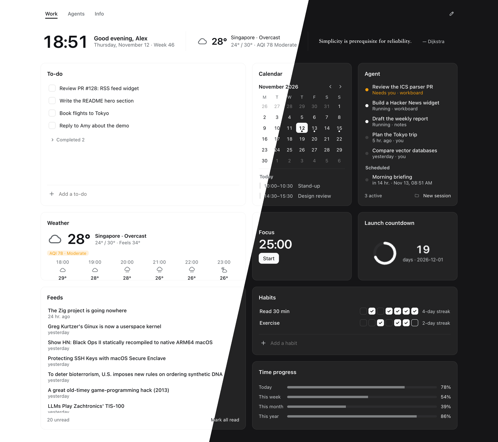
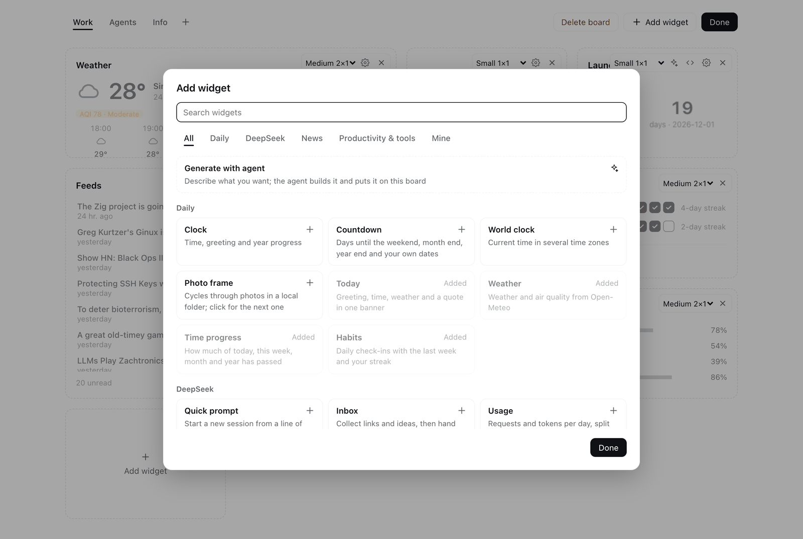
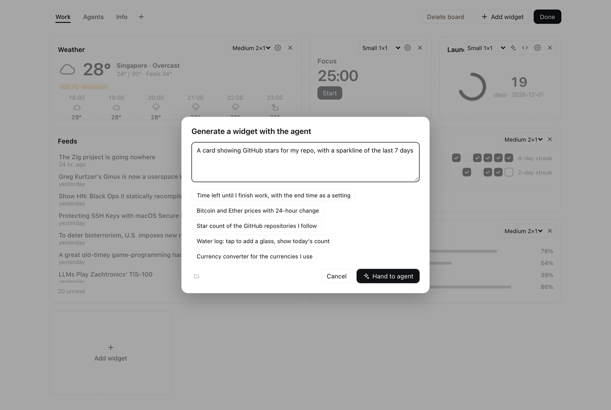
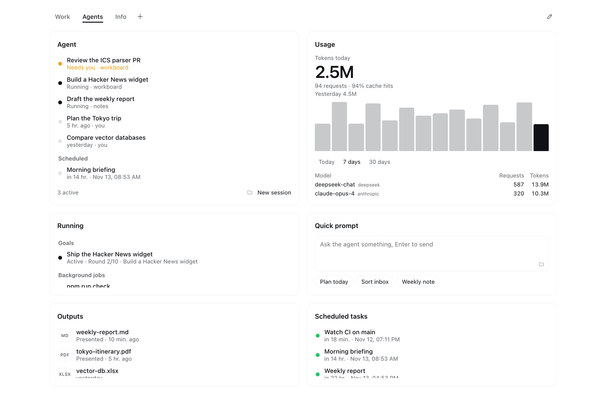
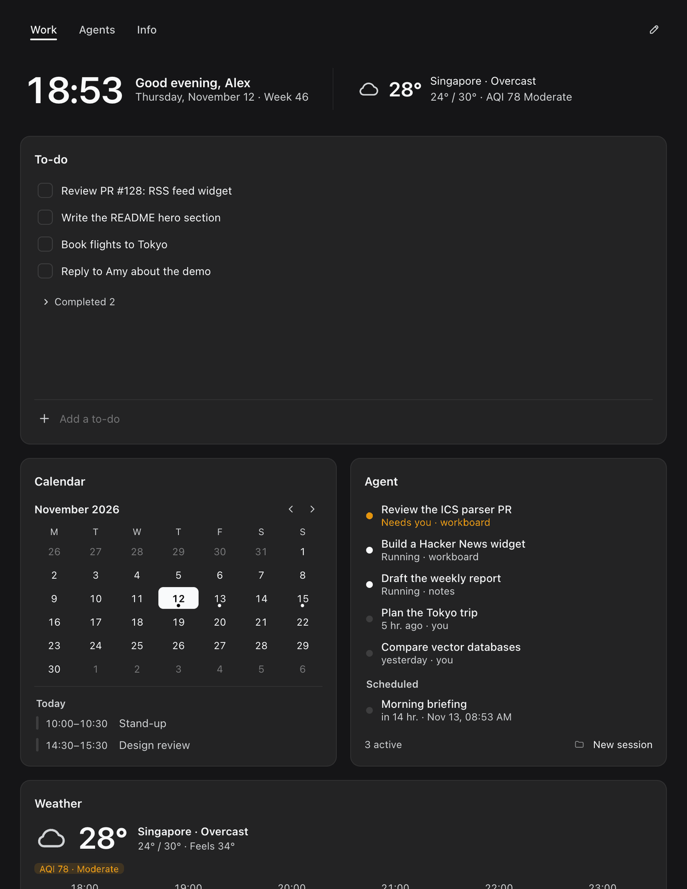

# Workboard

**A modular dashboard for [DeepSeek Harness](https://github.com/deepseek-ai/deepseek-harness). 42 widgets out of the box — and your agent builds the rest.**

[简体中文](README.zh.md) · [](https://www.npmjs.com/package/dsh-workboard) [](LICENSE)



## Highlights

### 42 widgets, ready to use

Open the widget gallery, search, and drop cards straight onto your board across four categories:

- **Agent workflows**: active and waiting sessions, running goals and background jobs, quick prompts, inbox, token usage and cost estimates, deliverables, scheduled tasks, and pinned sessions
- **Productivity & dev tools**: to-dos, scratch notes, ICS calendar, Pomodoro focus timer, ambient sound, quick links, Git repos, GitHub PRs and issues, system monitor, network speed and latency, clipboard history, and recent files
- **Daily essentials**: Today banner, clock, world clock, weather, countdowns, time progress, habit tracker, photo frame, and now playing
- **News & markets**: multi-source trending lists, RSS / Atom feeds, video subscriptions, stocks / forex / crypto markets, and daily quotes

Most widgets work with zero configuration; a few only ask for essentials like your city, an ICS calendar URL, or ticker symbols.



### Your agent builds the rest

Describe the card you want in a sentence and click **Hand to agent**. The agent writes the widget and places it directly onto your open board. Click the sparkle button on any custom card to ask for changes, or **Ask agent to fix** to hand runtime errors back to the agent.

Custom widgets run inside an isolated sandbox with no access to the host page, cookies, or undeclared network endpoints — they can only fetch URL prefixes explicitly declared by the widget.



### Built for agent workflows

Monitor sessions waiting for your approval, active goals and background jobs, token usage, deliverables, and scheduled tasks on a single board. Going the other way, your agent can read and update your to-dos, notes, inbox, and custom widgets from any conversation using built-in tools.



### Modular, adaptive, minimal

Cards snap to a four-column grid across six sizes. Drag to rearrange, resize on the fly, and organize widgets across tabbed boards. The layout reflows smoothly to narrow windows and follows the Harness light and dark themes. Each card does one job with zero visual clutter.



### Local and private

All boards and personal data stay in your local Harness profile. Every external network request is proxied and cached by the Host — the browser page never connects to third-party services directly.

## Quick start

In Harness, open **Plugins** → **Add plugin**, enter the package name, and install:

```
dsh-workboard
```

Or just tell your agent "install the plugin dsh-workboard". From the command line: `dsh plugin --profile web add dsh-workboard`.

Then open **Workboard** from the sidebar. The default board comes preset with common widgets such as Today, To-do, Trending, Outputs, Clipboard, Calendar, and System. Click **Edit** → **Add widget** to browse the gallery or ask the agent to build a custom card.

## For AI agents

If you are an agent interacting with Workboard:

- **Install**: call `plugin_manager install_bundle` with `target` set to `dsh-workboard`, or to this repository's absolute path when installing from source (local directories are linked rather than copied).
- **Built-in tools**:
  - `workboard_todos`: `list` · `add` · `complete` · `reopen` · `remove`
  - `workboard_note`: `read` · `append` · `replace`
  - `workboard_inbox`: `list` · `add` · `remove` · `clear`
  - `workboard_widget`: `list` · `get` · `create` · `update` · `set_data` · `remove`
  - `workboard_context`: read-only; one call returns what needs the user, calendar, weather, to-dos, habits, inbox, note, sessions, running work, scheduled tasks, outputs, usage, Git, and GitHub; pass `sections` to read only some
  - `workboard_brief`: `read` · `write` (the daily brief, in Markdown)
- **Build a custom widget**: load the `workboard-widget` skill ([`skills/workboard-widget.md`](skills/workboard-widget.md)) before calling `workboard_widget`. It documents card sizes, the `window.workboard` bridge API, sandbox rules, and theme tokens.
- **Limits & live sync**: up to 50 custom widgets, each with up to 200 KB of HTML and 200 KB of JSON data. The UI polls every 5 seconds, so your changes appear without reloading the page.
- **Storage**: `~/.dsh/storages/dsh_workboard.json`.

## Reference

<details>
<summary><b>All 42 built-in widgets</b></summary>

| Widget | Sizes | What it shows |
|---|---|---|
| **DeepSeek (Agent workflows)** | | |
| Attention | `l` `t` `m` `w` | One queue, by urgency, of sessions waiting for you, blocked goals, failed background jobs, PRs to review, carried-over to-dos, and the inbox; jump to the session, complete the to-do, or hand off to the agent |
| Agent | `t` `l` `m` `w` | Sessions waiting for your input first, followed by running and recent sessions, upcoming scheduled tasks, and a new-session button |
| Running | `t` `l` `m` `w` | Active goals and background jobs across sessions; jump to the session or stop a job |
| Daily brief | `l` `t` `w` `m` | A brief of your day that the agent writes from the dashboard; generate it any time or every day on a schedule |
| Quick prompt | `m` `w` `l` `t` `s` | Type a prompt or pick a preset to launch a new session right away in the chosen workspace |
| Inbox | `t` `l` `m` `w` | Quick capture for links and thoughts; hand everything to the agent to triage with one click |
| Usage | `l` `t` `m` `w` `s` | Token counts, request totals, cache hit rate, and per-model breakdown from local session logs, plus cost estimates when prices are set |
| Activity | `w` `l` `m` | A year of daily agent usage as a heatmap, shaded by tokens or requests, with active days and streaks |
| Service status | `t` `l` `m` `s` `w` | Status of DeepSeek, Claude, OpenAI, GitHub, npm, or any Statuspage you add; services with incidents float to the top |
| Outputs | `t` `l` `m` `w` | Deliverables presented by the agent, newest first; open, reveal in Finder, or jump to the source session |
| Scheduled tasks | `t` `l` `m` `w` | All scheduled tasks with recurrence and next run time; run now, pause, resume, or delete |
| Pinned sessions | `t` `l` `m` `w` | Your pinned sessions with a preview of each session's latest message |
| **Productivity & tools** | | |
| To-do | `l` `m` `t` | Open items on top, completed items collapsed; unfinished items from earlier days are badged as carried over |
| Notes | `l` `t` `m` `s` | Autosaving scratchpad; turn the current line into a to-do with one click |
| Calendar | `t` `l` `s` `m` | Month grid and selected day's schedule from one or more ICS subscriptions, including recurring events |
| Focus | `m` `s` | Pomodoro timer that keeps running across boards and panels, sends a system notification when done, and tracks today's completed sessions |
| Ambient sound | `m` `s` `w` `t` | Rain, waves, wind, fire, and pink / brown noise synthesized in the page; mix several, keeps playing across boards and panels, and can start with Focus |
| Links | `m` `s` `w` `t` `l` | One `name URL` per line (`http`, `https`, and `mailto` only) |
| Apps | `m` `s` `w` `t` `l` | Pick installed Mac apps from a searchable list and open them in one click; running apps get a dot (macOS only) |
| Git repos | `t` `l` `m` `w` | Current branch, uncommitted changes, ahead / behind counts, and branches whose upstream is gone; defaults to your Harness workspaces |
| GitHub | `t` `l` `m` `w` | PRs awaiting your review, your open PRs, and issues assigned to you via your signed-in `gh` CLI |
| System | `m` `s` `t` `l` `w` | CPU, memory, disk, battery, and a 5-minute CPU load sparkline |
| Recent files | `t` `l` `m` `w` | Newest files in `~/Downloads`, `~/Desktop`, or custom folders; open, reveal, or hand a file to the agent |
| Clipboard | `t` `l` `m` `w` | Text copied while the panel is open; copy again or send to the agent with a preset like Translate |
| Network | `m` `s` `t` `l` `w` | Live download / upload throughput, local and public IP, system proxy status, and latency to configured hosts |
| Ports | `t` `l` `m` `w` | TCP ports listening on this machine and the dev servers behind them, with project folder; open in the browser, reveal the folder, or stop the process (apps and system processes hidden by default) |
| **Daily** | | |
| Today | `bar` | Time, greeting, date, ISO week, current weather, and a daily quote (built-in, Hitokoto, or custom; click for another) |
| Clock | `m` `s` | Current time, greeting, date, and year progress |
| World clock | `m` `s` `w` `t` | Current time across multiple IANA time zones with local offset and day difference |
| Weather | `m` `s` | Current conditions, today's high and low, air quality, and hourly forecast |
| Countdown | `m` `s` `t` | Days until the weekend, month end, year end, and custom dates (`MM-DD` without a year repeats annually) |
| China holidays | `m` `s` `t` | Next public holidays in mainland China with days off and make-up workdays, plus today's lunar date |
| Time progress | `m` `s` `w` | Percentage of today, this week, this month, and this year elapsed |
| Habits | `m` `l` `t` `w` | Check in for any day of the past week and track your current streak |
| Photo frame | `m` `s` `t` `l` `w` | Cycles through photos from a local folder (`~/Pictures` by default) |
| Now playing | `m` `s` `w` `t` | Track, artwork, and progress of whatever macOS reports as now playing (Music, Spotify, QQ Music, browsers…), with play / pause and skip |
| **News & markets** | | |
| Trending | `l` `t` `m` `w` | Tabbed hot lists from Weibo, Zhihu, 36Kr, sspai, Hacker News, GitHub Trending, Product Hunt, and Reddit (Bilibili and V2EX optional) |
| Feeds | `t` `l` `m` `w` | Multiple RSS / Atom feeds merged chronologically; visited items dim automatically |
| AI papers | `l` `t` `m` `w` | Hugging Face daily papers ranked by upvotes and trending models; hand a paper to the agent to explain |
| Videos | `l` `t` `m` `w` | Latest uploads from YouTube channels (link, `UC…` ID, or `@handle`), Bilibili creators (space link or UID), and RSS feeds with images, with thumbnails |
| Markets | `t` `m` `s` `l` `w` | Forex (`USD/CNY`), China / HK / US equities (`sh600519`, `hk00700`, `usAAPL`), and crypto (`BTC`, `cg:<id>`) |
| Quote | `m` `w` `s` | A daily quote (click for another), sharing its source setting with the Today banner |

Note: Agent, Quick prompt, Inbox, Attention, and Daily brief share the same default workspace selection; PRs in Attention reuse the GitHub widget's query and cache. Shared preferences (your name, week start day, city, temperature unit, and quote source) can also be configured under **Settings → Workboard**. New built-in widgets added in future updates appear in the gallery without altering existing boards.

</details>

<details>
<summary><b>Network requests and local reads</b></summary>

All external network requests are made and cached by the Host:

- **Weather & city search**: [Open-Meteo](https://open-meteo.com), requested only after you set a city
- **Quotes**: [Hitokoto](https://hitokoto.cn), requested only when selected as the quote source
- **Calendars & feeds**: the ICS and RSS / Atom URLs you configure; the Feeds widget starts with [hnrss.org](https://hnrss.org) front page (ifanr and Ruan Yifeng's blog in Chinese), editable in its settings
- **Markets**: Tencent Finance (`qt.gtimg.cn`) for equities, [open.er-api.com](https://open.er-api.com) for exchange rates, and [CoinGecko](https://www.coingecko.com) for crypto
- **GitHub**: uses your local `gh` CLI and its existing sign-in
- **Trending**: public web endpoints for Weibo, Zhihu, 36Kr, sspai, Bilibili, and V2EX (unofficial and may break if a site changes), the [HN Algolia API](https://hn.algolia.com/api), the GitHub Trending page, and official Product Hunt and Reddit feeds; cached for 10 minutes
- **Videos**: YouTube channel RSS feeds (channel pages only to resolve an `@handle`), Bilibili's public creator archive endpoint (unofficial, rate-limited at times), and thumbnails proxied as data URLs; cached for 15 minutes
- **Network**: public IP from [ipinfo.io](https://ipinfo.io) (falling back to [ip.sb](https://ip.sb)) and host latency via `curl`, respecting the system proxy when set; tests Google, GitHub, and Cloudflare by default (Baidu, GitHub, and Google in Chinese)
- **Service status**: each configured page's Statuspage `/api/v2/summary.json`; the DeepSeek status page (hosted on Flashcat) has no public API, so its embedded page data is parsed (unofficial, may break if the page changes); defaults to DeepSeek, Claude, OpenAI, GitHub, and npm; cached for 2 minutes
- **AI papers**: the [Hugging Face](https://huggingface.co) daily papers and models APIs, falling back to the [hf-mirror.com](https://hf-mirror.com) mirror when huggingface.co is unreachable; cached for 30 minutes
- **China holidays**: [holiday-cn](https://github.com/NateScarlet/holiday-cn) data for this year and next via jsDelivr, falling back to GitHub raw; cached for 12 hours
- **Custom widgets**: limited to the `http(s)` URL prefixes declared in each widget's `fetch` allowlist; cached for 30 seconds

Widgets that only read local state:

- **Usage, Activity & Outputs**: read local session logs under `~/.dsh/sessions`
- **Attention**: combines Harness session, goal, and background job state with your local to-dos and inbox; with GitHub on, it calls the local `gh` CLI (sharing the GitHub widget's 5-minute cache)
- **Daily brief**: written by the agent in a new session after it reads the local data above through `workboard_context`; turning on **Every day** creates one daily Harness scheduled task, and turning it off deletes it
- **Git repos**: runs `git status` locally, and only runs `git fetch` when you click Fetch
- **System**: uses `vm_stat` and `pmset` on macOS
- **Photo frame**: uses `sips` on macOS to generate thumbnails cached in the system temp directory
- **Now playing**: reads the system now-playing session through the bundled [mediaremote-adapter](https://github.com/ungive/mediaremote-adapter) (`vendor/`, BSD-3-Clause), which runs under `/usr/bin/perl` and needs no permission; if that fails it falls back to asking Music or Spotify via `osascript` when already running, for which macOS asks once for Automation permission
- **Ports**: runs `lsof` and `ps` on macOS and Linux to list listening TCP ports, their working folder, and command line; **Stop** sends `SIGTERM` only to a process that is still listening on that port, with no extra permission
- **Apps**: on macOS, lists the top level of `/Applications`, `/System/Applications`, `~/Applications` and their `Utilities` folders, with Finder display names and icons via `osascript` (JavaScript for Automation), and running state via `ps`; it opens only apps found in those folders, with `open -a`, and needs no permission
- **Ambient sound**: synthesized with Web Audio in the page, with no files or network
- **Recent files**: lists only the top level of each configured folder
- **Clipboard**: polls `pbpaste` (macOS) or `wl-paste` / `xclip` (Linux) every 2 seconds while the card is visible; history stays in memory only

Data from earlier package names (`@lukeinx/dsh-desk` or `dsh-bento`) is migrated automatically on first launch while leaving the original files untouched.

</details>

<details>
<summary><b>Write a widget in another bundle</b></summary>

Another bundle can register a React component into the `workboard.widget` slot from its `client.js`. Attach the widget manifest to the component's static `workboard` property; the slot registration itself only needs `id`, `order`, and `label`:

```js
function Hello({size, config}) {
  return h('b', null, `Hello (${size})`);
}
Hello.workboard = {apiVersion: 1, sizes: ['m', 's']};

ctx.effect(() => ctx.slots.inject('workboard.widget', () => ctx.slots.register({
  name: 'workboard.widget', id: 'hello.widget', order: 100, label: 'Hello',
}, Hello)), 'hello widget');
```

See [`examples/hello-widget`](examples/hello-widget) for a complete bundle. A newly installed external widget is automatically placed once on the currently open board; other boards can add it from the gallery.

| Size | Columns × rows | Description |
|---|---|---|
| `bar` | 4 × ½ | Frameless banner |
| `s` | 1 × 1 | Small |
| `m` | 2 × 1 | Medium |
| `t` | 1 × 2 | Tall |
| `l` | 2 × 2 | Large |
| `w` | 4 × 1 | Wide |

Manifest fields:

- `sizes`: allowed size keys; `defaultSize` must be one of them and defaults to the first entry.
- `title: false`: hides the card header; `banner: true`: renders without a card frame.
- `description`: summary shown in the widget gallery.
- `category`: gallery section — `daily` (Daily), `agent` (DeepSeek), `news` (News), or `tools` (Productivity & tools). Any other value appears under Plugins.
- `settings`: fields for the card settings dialog: `{key, type, label, default?, options?, placeholder?}`, where `type` is `text`, `textarea`, `select` (with `options: [{value, label}]`), or `toggle`. Labels may be strings or functions returning a string.

The component receives `{size, config, editing, openSettings}` as props.

</details>

## Development

To run from source, clone the repository and enter its absolute path in **Add plugin** (local directories are linked rather than copied).

```sh
git clone https://github.com/lukeinx/dsh-workboard.git ~/dsh-workboard
npm run check   # syntax check, Host smoke test, and ICS parser tests
```

- `index.js`: Host routes (`/api/dsh-workboard/*`), storage tables, and agent tools
- `client.js`: sidebar entry, board container, and the 42 built-in widgets
- `lib/`: data fetchers, parsers, and system probes
- `skills/workboard-widget.md`: agent skill for building custom widgets

## Acknowledgments

Workboard builds on the following projects and services. Feed and trending content belongs to its respective publishers.

| Project or service | Used for | License or terms |
|---|---|---|
| [DeepSeek Harness](https://github.com/deepseek-ai/deepseek-harness) | Plugin host, theme tokens, and React runtime | MIT |
| [React](https://react.dev) | Widget rendering, provided by Harness | MIT |
| [Feather Icons](https://feathericons.com) | Selected icon paths adapted from Feather | MIT |
| [Open-Meteo](https://open-meteo.com) | Weather, air quality, and city search | Data under CC BY 4.0 |
| [Hitokoto](https://hitokoto.cn) | Optional Chinese quotes | Public API |
| [ExchangeRate-API](https://www.exchangerate-api.com) (`open.er-api.com`) | Foreign exchange rates | Free open access (attribution required) |
| [CoinGecko](https://www.coingecko.com) | Cryptocurrency prices | Public API (attribution required) |
| Tencent Finance (`qt.gtimg.cn`) | China, Hong Kong, and US stock quotes | Unofficial endpoint |
| [HN Algolia API](https://hn.algolia.com/api), [hnrss.org](https://hnrss.org) | Hacker News hot list and default English feed | Public API and feeds |
| Weibo, Zhihu, 36Kr, sspai, Bilibili, V2EX, GitHub Trending, Product Hunt, Reddit | Trending lists | Public pages, feeds, and unofficial endpoints |
| YouTube, Bilibili | Video subscriptions and thumbnails | Public channel feeds and unofficial endpoints |
| [ifanr](https://www.ifanr.com), [Ruan Yifeng's blog](https://www.ruanyifeng.com/blog/) | Default Chinese RSS feeds | Publishers' RSS feeds |
| [GitHub CLI](https://cli.github.com) | GitHub widget data | MIT |
| [mediaremote-adapter](https://github.com/ungive/mediaremote-adapter) | System now-playing info, bundled in `vendor/` | BSD-3-Clause |
| [ipinfo.io](https://ipinfo.io), [ip.sb](https://ip.sb) | Public IP lookup in the Network widget | Public API |
| Statuspage status pages of DeepSeek, Claude, OpenAI, GitHub, npm | Service status | Public status APIs; the DeepSeek page is parsed (unofficial) |
| [Hugging Face](https://huggingface.co), [hf-mirror.com](https://hf-mirror.com) | Daily papers and trending models | Public API and community mirror |
| [holiday-cn](https://github.com/NateScarlet/holiday-cn) | China public holidays and make-up workdays, via [jsDelivr](https://www.jsdelivr.com) | MIT |
| Classical texts (Laozi, Confucius, Xunzi, and others) | Built-in quotes | Public domain |

## License

[MIT](LICENSE)
