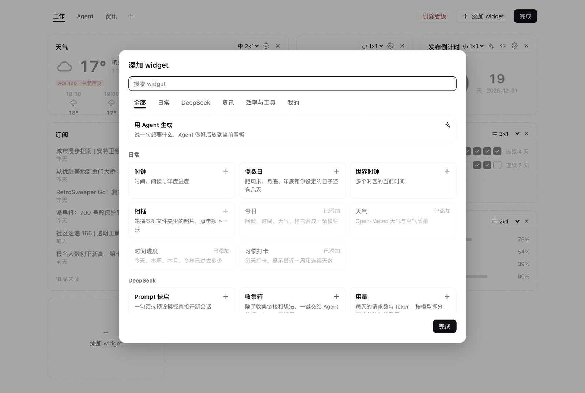
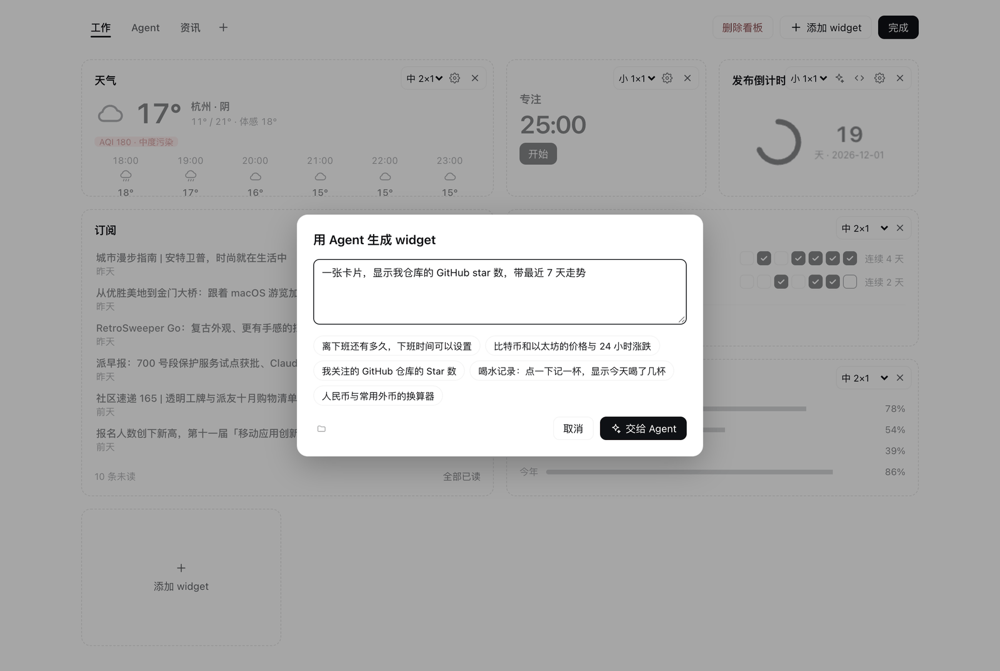
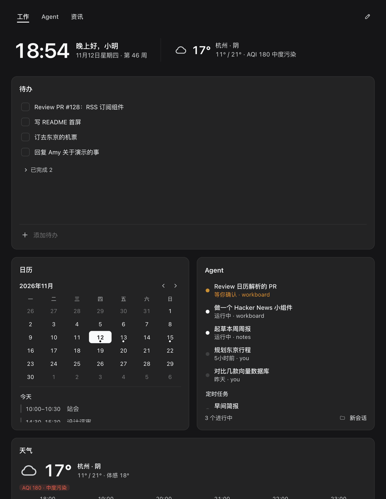
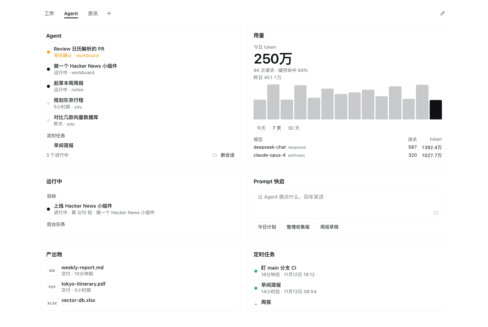

# 工作台 Workboard

**[DeepSeek Harness](https://github.com/deepseek-ai/deepseek-harness) 的模块化工作台。内置 31 个 widget，开箱即用；不够的，让 Agent 现做。**

[English](README.md) · MIT


## 亮点

### 内置 31 个 widget，开箱即用

待办、日历、天气、订阅、行情、Git、GitHub、用量统计、Agent 会话等。大多数不用配置，少数只需要填只有你知道的信息，比如城市、日历链接或股票代码。打开组件库，可以搜索，可以连续添加。



### 让 Agent 做新的 widget

用一句话描述想要的卡片，点「交给 Agent」，Agent 写好后卡片直接出现在你打开的看板上。之后点卡片上的星光按钮就能让 Agent 修改；运行出错时，「让 Agent 修复」把错误交回给它。自定义 widget 运行在沙箱里，访问不到页面和 cookie，也不能联网，只能请求它自己声明过的地址。



### 模块化、自适应、简约

卡片吸附在四列网格上，有六种尺寸，可以拖动、换尺寸，分在多个标签页看板里。布局随窗口宽度重排，明暗主题跟随 Harness。每张卡片只讲一件事，没有多余装饰。



### 为 Agent 工作而生

一块 Agent 看板就能看到等你确认的会话、进行中的目标和后台作业、token 用量、产出物和定时任务。Agent 也能在任意对话里通过内置工具读写你的待办、速记和收集箱。



### 数据留在本机

数据存在本机的 Harness profile 里。所有网络请求都由 Host 发出并缓存，页面本身不直连任何第三方。

## 快速开始

```sh
git clone https://github.com/lukeinx/dsh-workboard.git
```

然后在 Harness 对话里让 Agent 安装：

> 用 plugin_manager 安装 `~/dsh-workboard` 这个 bundle。

在侧栏打开「工作台」。默认看板有今日、待办、日历和速记，点「编辑」→「添加 widget」添加其余的。

## 写给 AI Agent

如果你是在操作工作台的 Agent：

- **安装**：`plugin_manager install_bundle` 指向本目录。本地目录是链接安装，不复制。
- **工具**：`workboard_todos`（`list` `add` `complete` `reopen` `remove`）、`workboard_note`（`read` `append` `replace`）、`workboard_inbox`（`list` `add` `remove` `clear`）、`workboard_widget`（`list` `get` `create` `update` `set_data` `remove`）。
- **做 widget**：调用 `workboard_widget` 前先加载 `workboard-widget` skill（[`skills/workboard-widget.md`](skills/workboard-widget.md)），里面有尺寸、`window.workboard` API、沙箱规则和主题变量。
- **限制**：最多 50 个自定义 widget，每个 HTML 和数据各不超过 200 KB。页面每 5 秒轮询，你的改动不用刷新就会出现。
- **数据**：`~/.dsh/storages/dsh_workboard.json`。

## 参考

<details>
<summary><b>全部 31 个 widget</b></summary>

| widget | 档位 | 内容 |
|---|---|---|
| 今日 | 横栏 | 时间、问候、日期、ISO 周、当前天气和每日格言（内置、一言或自定义），点格言换一条 |
| 待办 | `l` `m` `t` | 未完成在前、已完成折叠；之前留下的未完成项标「结转」 |
| 速记 | `l` `t` `m` `s` | 自动保存，当前行可转待办 |
| 日历 | `t` `l` `s` `m` | 月视图和所选日期的日程，来自一个或多个 ICS 订阅，支持重复日程 |
| 天气 | `m` `s` | 当前天气、今日最高最低、空气质量和接下来几小时 |
| 时钟 | `m` `s` | 时间、问候、日期和年度进度 |
| 格言 | `m` `w` `s` | 每日一句，点一下换一条；来源与今日横栏共用 |
| 倒数日 | `m` `s` `t` | 距周末、月底、年底和自定日子的天数；`12-25` 这样不写年份则每年重复 |
| 世界时钟 | `m` `s` `w` `t` | 多个 IANA 时区的时间、与本地的时差和日期差 |
| 专注 | `m` `s` | 番茄钟，切换看板或离开面板不中断，结束时发系统通知，记录今日个数 |
| 快捷链接 | `m` `s` `w` `t` `l` | 每行「名称 网址」，只接受 http / https / mailto |
| 时间进度 | `m` `s` `w` | 今天、本周、本月、今年已过去的比例 |
| Agent | `t` `l` `m` `w` | 等你确认的会话排最前，其次运行中和最近会话；即将触发的定时任务；一键新开会话 |
| 订阅 | `t` `l` `m` `w` | RSS / Atom，多个源按时间合并；打开过的条目变灰 |
| 习惯打卡 | `m` `l` `t` `w` | 最近一周可点选补卡，显示连续天数 |
| Prompt 快启 | `m` `w` `l` `t` `s` | 输入或点预设，直接在选定工作区新开会话并发送 |
| 收集箱 | `t` `l` `m` `w` | 随手丢进来的事情，一键交给 Agent 整理 |
| 用量 | `l` `t` `m` `w` `s` | 从本机会话日志统计 token、请求数、缓存命中和按模型拆分；填单价后估算花费 |
| 运行中 | `t` `l` `m` `w` | 各会话的长任务目标和后台作业，可打开会话或停止作业 |
| Git 工作区 | `t` `l` `m` `w` | 各仓库的分支、改动、领先 / 落后和上游已删除的分支；默认取 Harness 工作区 |
| GitHub | `t` `l` `m` `w` | 等我 review 的 PR、我的 PR 和指派给我的 issue，用本机已登录的 `gh` |
| 系统状态 | `m` `s` `t` `l` `w` | CPU、内存、磁盘、电池和最近 5 分钟的 CPU 曲线 |
| 相框 | `m` `s` `t` `l` `w` | 轮播本机文件夹（默认 `~/Pictures`）里的照片 |
| 行情 | `t` `m` `s` `l` `w` | 汇率（`USD/CNY`）、A 股 / 港股 / 美股（`sh600519`、`hk00700`、`usAAPL`）和加密货币（`BTC`、`cg:<id>`） |
| 热榜 | `l` `t` `m` `w` | 每个信源一个标签：微博、知乎、36 氪、少数派、Hacker News、GitHub Trending、Product Hunt 和 Reddit；B 站和 V2EX 可选 |
| 产出物 | `t` `l` `m` `w` | Agent 交付的文件，按时间倒序；点击打开，也可以在 Finder 中定位或跳到对应会话 |
| 定时任务 | `t` `l` `m` `w` | 全部定时任务的周期和下次运行时间；立即运行、暂停、恢复或删除 |
| 收藏会话 | `t` `l` `m` `w` | 你收藏的会话和各自最新一条消息 |
| 最近文件 | `t` `l` `m` `w` | `~/Downloads`、`~/Desktop` 或自定文件夹里最新的文件；打开、定位或交给 Agent |
| 剪贴板 | `t` `l` `m` `w` | 面板打开期间复制过的文本；再次复制，或带上「翻译」等预设发给 Agent |
| 网络 | `m` `s` `t` `l` `w` | 上下行速率、本机和公网 IP、系统代理，以及到你所列站点的延迟 |

Agent、Prompt 快启和收集箱共用同一个工作区选择。多个 widget 共用的设置（称呼、每周起始日、城市、温度单位、格言来源）也可以在「设置 → 工作台」里改。升级后新增的内置 widget 只出现在组件库，不会自动加入已有看板。

</details>

<details>
<summary><b>网络请求与本机读取</b></summary>

网络请求只由 Host 发出，结果在 Host 缓存：

- 天气和城市搜索：[Open-Meteo](https://open-meteo.com)，设置城市后才请求
- 格言：[一言](https://hitokoto.cn)，仅在格言来源选了一言时请求
- 日历和订阅：你添加的 ICS 与 RSS / Atom 地址
- 行情：股票走腾讯行情 `qt.gtimg.cn`，汇率走 [open.er-api.com](https://open.er-api.com)，加密货币走 [CoinGecko](https://www.coingecko.com)
- GitHub：通过本机 `gh` CLI，用它已有的登录
- 热榜：微博、知乎、36 氪、少数派、B 站、V2EX 走各站网页接口（非官方，站点改版可能失效），Hacker News 走 [HN Algolia API](https://hn.algolia.com/api)，GitHub 走 Trending 页，Product Hunt 和 Reddit 走订阅源；缓存 10 分钟
- 网络：公网 IP 走 [ipinfo.io](https://ipinfo.io)（失败时换 [ip.sb](https://ip.sb)），延迟测你列出的站点，都用 `curl`，设置了系统代理时经过代理
- 自定义 widget：只请求各自声明的 http(s) 地址前缀，缓存 30 秒

有几个 widget 只读本机。用量和产出物读 `~/.dsh/sessions` 下的会话日志；Git 工作区运行 `git status`，只在你点「获取远端」时执行 `git fetch`；系统状态在 macOS 用 `vm_stat` 和 `pmset`；相框在 macOS 用 `sips` 缩小照片，缓存在系统临时目录；最近文件只列各文件夹第一层；剪贴板在卡片显示期间每 2 秒读一次 `pbpaste`（macOS）或 `wl-paste` / `xclip`（Linux），历史只存在内存。

旧版 `@lukeinx/dsh-desk` 或 `dsh-bento` 的数据会在首次启动时复制过来，旧文件保留不动。

</details>

<details>
<summary><b>在另一个 bundle 里写 widget</b></summary>

widget 是一个 React 组件，由其他 bundle 在 `client.js` 里注册到 `workboard.widget` slot。manifest 挂在组件的静态属性 `workboard` 上；slot 注册参数只保留 `id`、`order`、`label`。

```js
function Hello({size, config}) {
  return h('b', null, `Hello (${size})`);
}
Hello.workboard = {apiVersion: 1, sizes: ['m', 's']};

ctx.effect(() => ctx.slots.inject('workboard.widget', () => ctx.slots.register({
  name: 'workboard.widget', id: 'hello.widget', order: 100, label: 'Hello',
}, Hello)), 'hello widget');
```

完整示例见 [`examples/hello-widget`](examples/hello-widget)。新装的 widget 只自动加入当前打开的看板一次，其他看板只在组件库里出现。

| 档位 | 列 × 行 | |
|---|---|---|
| `bar` | 4 × ½ | 无框横栏 |
| `s` | 1 × 1 | 小 |
| `m` | 2 × 1 | 中 |
| `t` | 1 × 2 | 竖 |
| `l` | 2 × 2 | 大 |
| `w` | 4 × 1 | 通栏 |

manifest 字段：

- `sizes` 列出允许的尺寸；`defaultSize` 须在其中，默认取第一个。
- `title: false` 隐藏卡片标题，`banner: true` 无框渲染。
- `description` 显示在组件库里。
- `category` 决定在组件库里的分组：`daily`（日常）、`agent`（DeepSeek）、`news`（资讯）、`tools`（效率与工具）；其他值归入「插件」。
- `settings` 是设置弹窗的字段列表：`{key, type, label, default?, options?, placeholder?}`，`type` 可选 `text`、`textarea`、`select`（配 `options: [{value, label}]`）、`toggle`。label 可以是字符串，也可以是返回字符串的函数。

组件收到 `size`、`config`（这张卡保存的设置）、`editing` 和 `openSettings()`。

</details>

## 开发

```sh
npm run check   # 语法检查 + Host 端冒烟 + ICS 测试
```

`index.js` 是 Host 端 `/api/dsh-workboard/*` 路由、存储和 Agent 工具；`client.js` 是侧栏入口、面板和内置 widget；`lib/` 是各数据源与解析器；`skills/workboard-widget.md` 是 Agent 写 widget 的指南。

## 致谢

工作台建立在下列项目和服务之上。订阅和热榜里的内容归各自发布者所有。

| 项目或数据 | 用途 | 许可或条款 |
|---|---|---|
| [DeepSeek Harness](https://github.com/deepseek-ai/deepseek-harness) | 插件宿主、主题变量、React 运行时 | MIT |
| [React](https://react.dev) | 所有 widget，由 Harness 提供 | MIT |
| [Feather Icons](https://feathericons.com) | 部分图标路径改编自此 | MIT |
| [Open-Meteo](https://open-meteo.com) | 天气、空气质量和城市搜索 | 数据 CC BY 4.0 |
| [一言](https://hitokoto.cn) | 中文格言（可选） | 公开 API |
| [ExchangeRate-API](https://www.exchangerate-api.com)（`open.er-api.com`） | 汇率 | 免费开放接口，需署名 |
| [CoinGecko](https://www.coingecko.com) | 加密货币价格 | 公开 API，需署名 |
| 腾讯财经行情（`qt.gtimg.cn`） | A 股、港股、美股行情 | 非官方接口 |
| [HN Algolia API](https://hn.algolia.com/api)、[hnrss.org](https://hnrss.org) | Hacker News 热榜和默认英文订阅 | 公开 API 与订阅源 |
| 微博、知乎、36 氪、少数派、B 站、V2EX、GitHub Trending、Product Hunt、Reddit | 热榜 | 各站公开页面、订阅源与非官方接口 |
| [爱范儿](https://www.ifanr.com)、[阮一峰的网络日志](https://www.ruanyifeng.com/blog/) | 默认中文订阅 | 发布者的 RSS |
| [GitHub CLI](https://cli.github.com) | GitHub widget | MIT |
| [ipinfo.io](https://ipinfo.io)、[ip.sb](https://ip.sb) | 网络 widget 里的公网 IP | 公开 API |
| 经典文献（老子、孔子、荀子等） | 内置格言 | 公有领域 |

## 许可

[MIT](LICENSE)
